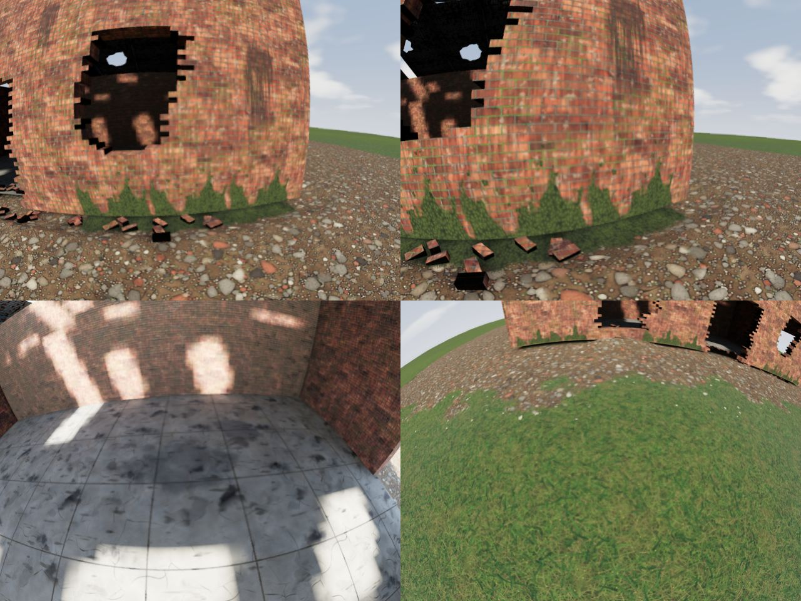
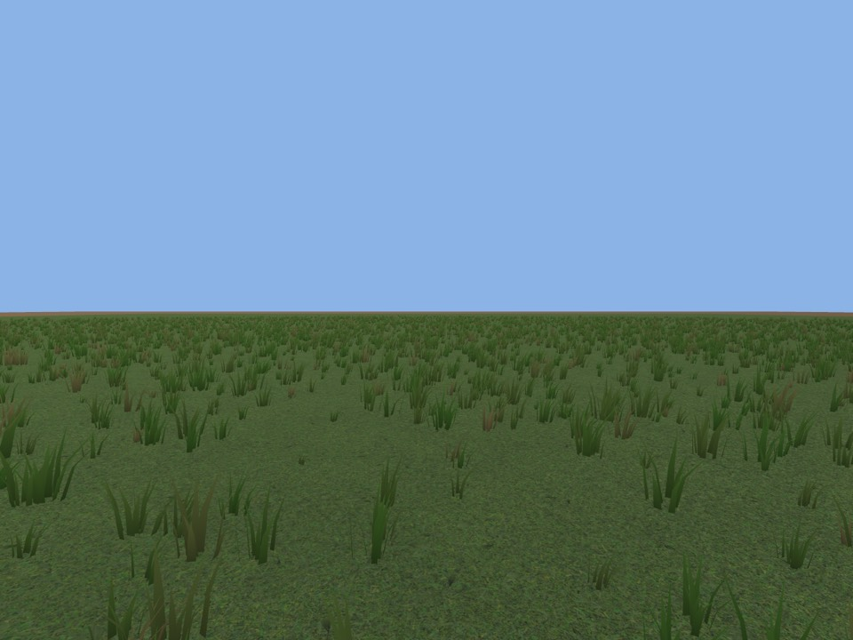
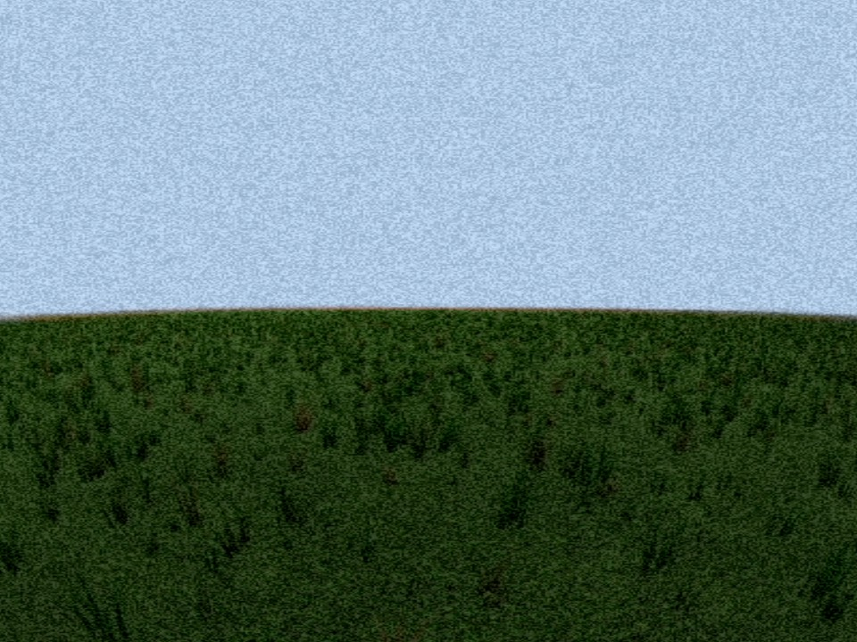

# Building a Map

A Map is built by a script, not drawn by hand. An agent writes a Blender script in `assets-src/maps/<id>/build.py`; Blender runs it with no window and writes the Map's `.glb` (binary glTF, the standard 3D file) into the built-in Pack, at `packs/opendrone/maps/<id>/`. Both the script and the `.glb` are committed: the script is the source, and the `.glb` is a build output, like a compiled program. [Checking a Pack](verification/checking-a-pack.md) says what the Pack checker demands of the file. The terms are in [World and content](context/world.md).

The Maps are CC0, like everything agents make, and the scripts are MIT or Apache-2.0 ([ADR-0014](adr/0014-licences-for-libraries-and-assets.md)). The first Map built this way is the Skate Park, and the second is Bando.

## Building and checking

You need Blender, the exact version [`assets-src/blender-version.toml`](../assets-src/blender-version.toml) pins (5.2.2 today). That file is the one place the version is written: this command and CI both read it, and the command refuses any other Blender. It looks for `blender` on the path, in `/Applications/Blender.app` and in Program Files, or wherever the `BLENDER` variable points.

```sh
cargo xtask maps                                   # rebuild every Map's .glb into the Pack
cargo xtask maps --check                           # build into target/maps-check/ and say whether the committed .glb is the same bytes
cargo xtask maps --previews target/map-previews    # also render pictures of every Map
cargo xtask maps --previews target/map-previews --update-preview   # and copy the new preview.png into the Pack
```

A Map builds in about a second. The pictures take a minute or two, because they are rendered on the processor (CI has no graphics card): a plan, a three-quarter view (and a smaller one, which becomes the Pack's `preview.png`), and what each Quad's camera sees landed on the Launch Spot and from a few places a pilot will fly. A metre grid and 1.8 m figures are drawn on them for scale, and they use a plain 110° view with none of the game's textures or lighting, not the Quad's fisheye Lens, which only the game draws. [Seeing the Map as the game draws it](#seeing-the-map-as-the-game-draws-it) says how to see it with the game's own textures and lighting.

## What a script does

Each script makes a `MapBuilder` ([`assets-src/lib/odmap.py`](../assets-src/lib/odmap.py)), adds shapes to it, places the Launch Spot and exports. The builder takes the shapes the Maps need: boxes, straight walls of boxes round their openings (doorways, windows and gaps), posts and cones, rails, steps and banks (a side outline cut out across a width), a pipe, a sheet over a rectangle with a height at every corner (the bowls), and trees and light poles. Each shape is given a **material** by name and a **collider** tag:

- `box` for a box, found again from its corners by the Pack checker;
- `convex` for a post or cone that stands straight up (its corners are rounded flat, so a tilted one can't be convex);
- `trimesh` for everything else solid: a closed mesh is a solid and an open one is a surface;
- `none` for a part that is only drawn.

The tags and the Launch Spot rules are in [Checking a Pack](verification/checking-a-pack.md#a-map-mapsid) and the [World and content](context/world.md) rules: the Launch Spot is on open flat ground, with at least 3 m clear all round and open sky above, facing the Map's main feature. The Skate Park's script, [`assets-src/maps/skate-park/build.py`](../assets-src/maps/skate-park/build.py), and Bando's, [`assets-src/maps/bando/build.py`](../assets-src/maps/bando/build.py), keep each size of #17's table of must-have features, and [`crates/pack/tests/skate_park.rs`](../crates/pack/tests/skate_park.rs) and [`crates/pack/tests/bando.rs`](../crates/pack/tests/bando.rs) measure them in the finished Map. Bando's thin parts are solid at their real thickness (6 cm rails, a 5 cm hook cable, 3 cm rebar), and its ceilings and floors are colliders, so the ceiling effect and the continuous collision check have something to work on.

### The same bytes on every computer

CI rebuilds each Map with Blender on Linux and requires the very same `.glb` as the committed one, so a script has to give the same bytes on a Mac, on Windows and on Linux. Blender's own maths is 32-bit, and its last digit can differ between processors, so the scripts never use it for anything that reaches the file:

- every shape is worked out in plain Python with 64-bit numbers ([`assets-src/lib/odgeom.py`](../assets-src/lib/odgeom.py)), placed in the Map there, and handed to Blender with every object at the origin and unturned;
- every corner is rounded to 0.1 mm, then to the 32-bit number the file stores;
- every solid is cut into triangles by a fixed rule, never by Blender's own triangulation, and a convex solid's four-cornered faces are cut along the diagonal that leaves no dent;
- no Blender unwrap, no Blender lightmap pack and no bevel or boolean operation, whose output order Blender doesn't keep from run to run ([the research](research/asset-pipeline.md) measured that); the second picture-coordinate set that [baked light](#baked-light) needs is made in plain Python;
- the picture coordinates are the Map's own metres divided by the material's repeat size, so a picture runs on from one object to the next;
- the file has no normals (the game works them out) and no pictures, compressed meshes or animations, and a mesh has vertex colours only when a second material is blended into it ([Blending two materials](#blending-two-materials)): the builder writes them as 16-bit whole numbers that stand for 0 to 1, from weights that are whole 255ths, so they are exact on every computer.

If you change a script, run `cargo xtask maps` twice and `--check`: the bytes must not change between runs.

If a Map built on a Mac or Windows differs from what CI builds on Linux, the `maps` download of the **Maps** check holds the one CI built: commit that, and tell the Reviewer which step differed.

## Materials and textures

Every object's material is named after an entry in the **material library**, [`assets-src/materials.toml`](../assets-src/materials.toml): its flat colour, its roughness and, if it has one, the CC0 texture behind it. The `.glb` carries only the name and the flat colour. The game gives each name its pictures.

- The textures are from [Poly Haven](https://polyhaven.com/license) and [ambientCG](https://docs.ambientcg.com/license/), both CC0, at 1K, as JPG: a colour picture and a normal map each. The manifest lists each file's address, who made it and the SHA-256 of the file.
- `cargo xtask textures` downloads them into `assets-src/textures/`, which git ignores: pictures are fetched, never committed. It refuses any file whose checksum differs from the manifest's and keeps nothing it refused. `cargo xtask textures --pin` writes the checksum of a texture you just added; look at the pictures before committing it, and check they have no brand logos or graffiti.
- `cargo xtask credits` writes [`CREDITS.md`](../CREDITS.md) from the manifest, and CI checks it is up to date.
- Adding a material: add it to `[materials]` (and its texture to `[textures]`), run `cargo xtask textures --pin`, then `cargo xtask credits`. A texture no material uses is refused, so nothing is credited for nothing.

The game reads the library from the repo, so it draws a Map with pictures only when it runs from a repo where `cargo xtask textures` has run. You don't have to remember that: `./play` (`play.cmd` on Windows), or `cargo xtask play`, runs it for you, then builds and starts the game ([Starting the game from any checkout](pilot-guide.md#starting-the-game-from-any-checkout)). Without the pictures, every material is drawn in its flat colour, and the Map flies the same. A packaged game finds its pictures once the release ticket lays them out.

## Baked light

A detailed Map is lit by **baked light** ([ADR-0024](adr/0024-detailed-maps-are-made-from-scratch-and-lit-by-a-baked-atlas.md)): Blender works out, once, how much sun and sky light reaches every spot of every surface, with bounces off the walls and the shade that crowding makes, and keeps the answer in a picture, the **light atlas**. The game then lights the Map by looking the answer up ([what the game does with it](#what-the-game-does-with-it)). The Skate Park and Bando don't ask for it and are lit as before.

### Asking for it, in the script

```python
m = MapBuilder(...)
m.lightmap(texel_cm=20)                       # one texel of the atlas is 20 cm of the Map
m.box_h("pillar", ..., light_cm=10)           # this one shape gets finer light
```

- `lightmap(texel_cm)` gives every drawn mesh a second set of picture coordinates (`TEXCOORD_1` in the `.glb`) that lays all of them flat, side by side, in one atlas. A smaller `texel_cm` means sharper shade and a bigger atlas: 10 is fine detail, 25 is coarse.
- A shape's own `light_cm=` overrides the density for that shape, for a part that deserves finer light than the rest, or far-off ground that needs none.
- A flat piece longer than `max_chart` texels (512 by default) is made coarser to fit, so a 2 km ground costs the same as a 50 m floor. The atlas must fit in `max_size` texels a side (8192 by default); if it doesn't, the script stops and says to raise `texel_cm`. There is one atlas per Map, so a Map that needs more asks for coarser light, or for its far parts to be coarser.
- Parts that are `od_collision_only` get no picture coordinates and cast no shade: nothing draws them.
- The unwrap is plain Python, written the way the rest of the Map is ([`odlight.py`](../assets-src/lib/odlight.py)): it cuts each mesh into flat charts of faces that point nearly the same way, scales each chart to the density, leaves 2 empty texels all round each chart, and packs them in a fixed order. It never uses Blender's `smart_project` or island packing, so the `.glb` is the same bytes on every computer, as [above](#the-same-bytes-on-every-computer).

### The light, in `map.toml`

```toml
[light]
sun_elevation = "37 °"       # how high the sun is: 0 ° on the horizon, 90 ° overhead
sun_azimuth   = "225 °"      # the compass direction the sun is in: 0 north, 90 east, 225 south-west
sun_colour    = "#fff2d6"    # sRGB, as in a paint program
sun_strength  = "3.0"        # a plain number, from 0 up to 1000
sky_colour    = "#a5c4f0"
sky_strength  = "0.5"
```

Every value is needed, and [the Pack checker](verification/checking-a-pack.md#a-map-mapsid) refuses a wrong one in a sentence. The strengths are in the atlas's own units: `sky_strength` is how bright a white surface facing up under an open sky is, and `sun_strength` how bright a white surface square-on to the sun is, and the sky is one even colour all round (measured on Bando: flat ground under a sun 50 ° up with `sun_strength` 3.0 and `sky_strength` 0.5 bakes to about 2.5 in the red channel, which is 3.0 × sin 50 ° = 2.3 from the sun plus the sky's share). The picture holds light only, and the game multiplies it by each surface's own colour. A sun of about 3 against a sky of about 0.5 gives sunlit ground about 6 times as bright as its shade.

### Baking it

```sh
cargo xtask maps --bake <id>                  # bakes one Map's light, at 512 samples a texel
cargo xtask maps --bake <id> --samples 128    # a quick look
cargo xtask maps --bake <id> --samples 1024   # the one to commit
```

It rebuilds the Map's `.glb` and, with Blender's Cycles on the processor, bakes the `[light]` into `packs/opendrone/maps/<id>/<id>.light.exr`. It also writes `<id>.bake.toml` beside it, which says which `.glb` and which `[light]` values the atlas was baked from, plus the size, the samples and how long it took. Commit all three.

- **What gets baked.** Sun and sky light, with up to 6 bounces, from a sun half a degree wide (so shade has the soft edge a real shadow has). Bounced light takes the colour of what it bounces off, from each material's flat colour in the `.glb`: a brick wall's red spills onto the floor beside it, but the texture's pattern doesn't. Shade from crowding (the dark corner where a wall meets the floor) is part of it.
- **Noise.** Cycles can't denoise a bake, so the atlas has a little noise, which shows most indoors, where all the light has bounced. It falls with the square root of the samples and the time rises with them. 256 samples is fine for the sunlit outside and grainy inside; 1024 is clean on Bando. Bake with plenty before committing.
- **Time.** It grows with the texels in the atlas times the samples. The table below has the times on the maintainer's M4 Mac mini (10 cores).
- **The format, `.exr`.** The atlas is an OpenEXR picture of half-size floats (16 bits a channel), ZIP-compressed. Sunlit and shaded parts differ by a factor of ten and more, and the Factory's halls will differ by 5 to 6 stops, which an 8-bit picture can't hold without banding or a scale that `map.toml` would have to carry (a PNG of the same atlas is a third of the size, but sun above 1.0 would be cut off). EXR holds the real numbers, so the game needs no decoding rule, and it is what Blender writes without help. It costs size (about 1.7 to 14 MB for Bando, below; ZIP gives about a fifth of the raw size, DWAA a tenth, but the game's reader may not open it) and, in the graphics card, 8 bytes a texel if the game keeps it in half floats, or 16 if the loader makes full floats: the game's ticket measures the load time and the memory, and may turn the atlas into a compressed form at load time.
- **The atlas isn't rebuilt in CI**, because Cycles is allowed to differ a little from run to run. So that the committed atlas can't quietly go out of date, `cargo xtask maps --check` reads `<id>.bake.toml` and fails if the atlas file is missing, if the `.glb` Blender builds now isn't the one it was baked from (the shapes or the second UV set changed), or if the `[light]` values aren't the ones it was baked with. The fix is the `--bake` command above.
- **The unwrap is checked everywhere.** `assets-src/lightmap-uv.toml` holds the SHA-256 of each Map's `.glb` built with a second UV set at 25 cm per texel, whether the Map asks for one or not. `cargo xtask maps` writes it and `--check` demands it, so CI proves on Linux that the unwrap gives the same bytes as on a Mac. The unwrap's own rules (charts, margins, density, no overlap) are checked in plain Python by `python3 -m unittest discover -s assets-src/lib`, which CI runs too.

### What the game does with it

A Map is baked when all three go together: a `[light]` table in `map.toml`, a second set of picture coordinates (`TEXCOORD_1`) on every drawn mesh in the `.glb`, and the atlas `<id>.light.exr` in the Map's folder. The Pack checker refuses a Map that has some and not the others, in a sentence that says which is missing. A Map with none of the three is drawn as before.

For a baked Map the game:

- draws every part of the Map lit by the atlas alone, looking each spot up on the part's second coordinates and multiplying what it finds by the surface's own colour and picture. There is no real-time sun on the Map's parts, so no cascaded shadow maps either: all the shade is in the atlas;
- lights the Quad, which isn't in the atlas, with the Map's **sky** as ambient light (`sky_colour` and `sky_strength`) and, for a little shading, a share (15%) of the Map's **sun** from where `sun_elevation` and `sun_azimuth` put it, with no shadows. A Quad flying into a building is lit like one outside it, apart from the sun's share: it isn't shaded by the atlas;
- draws a **sky** behind the Map, made from the same `[light]` and nothing else: no new keys and no picture files. The game builds it once, when the Map loads ([`sky.rs`](../crates/opendrone/src/sky.rs)), the same on every computer. It is a gradient from `sky_colour` straight up to a paler, whiter haze at the horizon, a sun disc in `sun_colour` where `sun_elevation` and `sun_azimuth` put it with a soft glow round it, a few soft clouds that thin out towards the horizon and leave the sun clear, and a dull ground below the horizon (the Backdrop's ground hides it anyway). It is drawn at the atlas's own brightness: the zenith is `sky_colour` times `sky_strength`, so it is about as bright as a white surface under that open sky, and the sun's disc is far brighter than the ground it lights. So seen from a dark hall the sky is blown out white, as a real camera sees it, and a plain view shows it at its real level beside the sunlit ground. A strength of 0.25 gives a deep, dim sky and 1 a bright one. It is one cubemap of 6 × 256 × 256 half floats, 3.1 MB in the graphics card, drawn on the FPV Camera, the chase camera and the cameras of `--render-views`. A Map with no `[light]` (the Skate Park, Bando) has no sky of its own: it keeps the flat light blue it always had;
- reads the atlas into half floats in the graphics card, so it takes 8 bytes a texel (the table above has the sizes). It reads the OpenEXR file itself ([`light_atlas.rs`](../crates/opendrone/src/light_atlas.rs)) rather than through Bevy's `exr` feature, which would turn on `num-complex`'s `std` for the whole workspace and break the [wall round the core](adr/0003-crate-split-and-flight-inputs.md). So it reads what the bake writes, one picture in scanlines with red, green and blue as half or 32-bit floats, uncompressed or `ZIP` or `ZIPS`, and refuses any other form in a sentence.

A strength of 1 is as bright as the real-time sun the Skate Park and Bando have: a white surface square-on to a `sun_strength` of 1 is drawn as a white surface is under that sun. A strength of 3 is three times as bright (bright enough to look washed out in a plain view, which has a fixed exposure), so a Map meant to sit beside the other two uses strengths near 1. If the atlas can't be read, the game says so in its log and draws the Map with the real-time sun, as a Map with no atlas.

To see it, use `--render-views` ([Seeing the Map as the game draws it](#seeing-the-map-as-the-game-draws-it)): the pictures show the baked light.

### What it costs: Bando

A throwaway copy of Bando (a 70 × 50 m site with a five-floor building, 745 shapes, 13,248 triangles, ground to 2 km), baked with the `[light]` above at 256 samples. The atlas is EXR, half floats, ZIP. Times are on the maintainer's M4 Mac mini and vary by half again with what else the computer is doing.

| Texel | Atlas | Atlas file | In the graphics card (half floats) | Bake time |
|---|---|---|---|---|
| 40 cm | 4096 × 460 | 1.7 MB | 15 MB | 47–61 s |
| 25 cm | 2048 × 1260 | 3.4 MB | 21 MB | 88 s |
| 20 cm | 4096 × 772 | 4.8 MB | 25 MB | 79–159 s |
| 10 cm | 2048 × 4076 | 14.3 MB | 67 MB | 7 to 8 minutes |

At 1024 samples the 40 cm atlas took 258 s. About 85 to 90% of the atlas is covered by charts. The rest is the gaps between them, and the undersides of boxes (which nothing sees, but which can't be told apart from other faces).

## Seeing the Map as the game draws it

The Blender pictures above don't show what the game shows: they have no textures, no shadows from the sun and no Video Look. To see the Map as the game draws it, ask the game itself. It starts the real renderer, with the same textures, materials and lighting as a flight, puts a camera where you say, saves one PNG for each view and quits:

```sh
cargo run -p opendrone -- --map bando --render-views target/map-views \
  --view "name=launch" \
  --view "name=front at=0,-12,2 toward=0,0,3 fov=100" \
  --view "name=what-the-pilot-sees look=analog"
```

That writes `bando-01-launch.png`, `bando-02-front.png` and `bando-03-what-the-pilot-sees.png` into `target/map-views/`: the Map's short id, the view's place in the list, and its name. It prints each file as it saves it. A Map is one run, because the game opens one Map at a time: do the other with a second command, or a loop (`for map in bando skate-park; do ...; done`). The game takes a few seconds to start, and a Video Look view waits about three seconds for Auto-exposure to settle, so pay the start-up once by putting every view of a Map in one run.

A view is a line of `key=value` words, and every key is optional:

| Key | Says | If left out |
|---|---|---|
| `name` | part of the file's name (letters, digits, `-` and `_`) | `view` |
| `at` | where the camera is: `east,north,up` in metres from the Map's origin, as in the Map's script | the Quad's camera, landed on the Launch Spot |
| `toward` | a point to look at, `east,north,up` in metres | see `heading` and `pitch` |
| `heading` | the compass heading to look along, in degrees: 0 north, 90 east | the Launch Spot's heading |
| `pitch` | how far to look up, in degrees: -90 straight down, 90 straight up | the Quad's Camera Tilt |
| `fov` | the FOV in degrees across the picture's diagonal, as the game's FOV is measured | the Quad's own FOV in a Video Look, 110 in a plain view |
| `look` | `plain`, `analog` or `digital` | `plain` |
| `rotors` | how fast the Quad's rotors turn in the picture, from 0 (at rest) to 1 (a motor's top speed): 0 shows the blades standing still, about 0.5 a hover's blurred disc, and a very small number such as 0.002 the blades turning ([the Quad's rotors](context/camera.md#the-quads-rotors-in-the-picture)) | the Simulation's motors, which are at rest on the Launch Spot |

`toward` doesn't go with `heading` or `pitch`. With no view at all, you get one plain view from the Launch Spot, which is what the Quad's camera sees there. The FOV runs from 90° to 170° in a Video Look, as it does in the game, and from 20° to 170° in a plain view.

A **plain** view is a flat lens at a fixed exposure with the Quad hidden: the Map as the sun lights it, for looking at a wall, a stair or a room from wherever you like. A **Video Look** view is the Quad's own FPV Camera, through its fisheye Lens, Auto-exposure, grain and Look, with its lens put where the view says: it is what the pilot would see from there. Use it for anything about whether the Map flies and reads well on the pilot's screen, and plain for the Map itself. A Video Look view is drawn in the largest 4:3 picture that fits the image, so keep the default size, 1280x960, or another 4:3 one; `--size WxH` sets it. The camera settings go in each view, so `--look`, `--fov`, `--aspect` and `--tilt` aren't taken with this command. `--quad whoop-65` or `--quad freestyle-5` picks the Quad whose camera the Video Look views use.

To keep a list of views, write them one a line in a file, with `#` for notes, and pass it with `--views FILE`. `--view` and `--views` can be mixed, in the order given.

Pictures are drawn with the Map's textures when `cargo xtask textures` has run, and in flat colours when it hasn't: the same as the game ([Materials and textures](#materials-and-textures)). The game's Auto-exposure takes a few seconds to settle after a flight starts, so a Video Look picture matches what the pilot sees once the picture has settled, not in the first second.

**Running it.** The command needs a GPU and opens a window for a moment, as `--screenshot` does, so run it on the maintainer's Mac or another computer with a screen; it draws into an image of its own, not the window. CI has no GPU, so nothing in CI runs it, and there is no golden-image comparison: you look at the PNGs, with the Read tool or an image viewer. It stops after a minute if a view is never drawn, and says so.

**Checking it by hand.** The window part has no automated check. To see that a picture is what the game shows, fly to the same camera and compare: `cargo run -p opendrone -- --map bando --no-screens --screenshot target/game.bmp --seconds 20 --size 1280x960` saves the game's own picture from the Launch Spot, and `--render-views` with `--view "look=analog"` should show the same picture, apart from the noise.

## Materials made from scratch

A detailed Map (the Factory is the first) doesn't use downloaded pictures: its surfaces are drawn by scripts that agents write, and the pictures they make are committed ([ADR-0024](adr/0024-detailed-maps-are-made-from-scratch-and-lit-by-a-baked-atlas.md)). Nothing is downloaded, no outside picture goes in, and the pictures are CC0 like everything agents make. Skate Park and Bando keep their downloaded textures. The materials, which are the Factory slice's, look like this (the colour picture of each, the way [`cargo xtask generate-textures`](#adding-one) makes it):


| Material | One repeat | Picture | Cost |
|---|---|---|---|
| `brick_red_weathered` | 1.8 m | 1K | 638 KB |
| `brick_painted_peeling` (paint over plaster over brick) | 1.8 m | 1K | 456 KB |
| `concrete_floor_worn` (the hero surface) | 3 m | 2K | 1.8 MB |
| `concrete_wall_rough` (board-formed, tie holes) | 2 m | 1K | 486 KB |
| `steel_beam_rusted` | 1 m | 1K | 566 KB |
| `roof_corrugated_rusted` | 1.2 m | 1K | 495 KB |
| `ground_dirt_rubble` | 2 m | 1K | 936 KB |
| `grass_weeds` | 2 m | 1K | 1.3 MB |
| `glass_wired_grimy` (window glass, opaque) | 1 m | 512 | 214 KB |
| `wood_charred` (burnt timber) | 1 m | 512 | 339 KB |
| `bark_rough` | 1 m | 512 | 153 KB |
| `leaves_mixed` (leaves and weeds) | 0.6 m | 512 | 118 KB |
| `sign_faded` (one board, shown once) | 4 m | 1K | 242 KB |
| `graffiti_brick` (one patch, shown once) | 3.6 m | 1K | 935 KB |

Each material has three pictures in `assets-src/generated/<name>/`: `diffuse.jpg` (the colour), `normal.jpg` (the normal map, in the same convention as Poly Haven's) and `roughness.jpg`. The game reads the colour and the normal map, and draws a part with them as it does a downloaded texture; a material that says `roughness_map = true` has its roughness picture read too ([Wet, rough and metal surfaces](#wet-rough-and-metal-surfaces)). All the tiled ones and the large-scale picture together are about 9 MB. Pictures are 2K at most for a hero surface and 1K otherwise. A picture never holds a one-off mark (graffiti, a spalled patch with a rebar, a stencilled block, a painted band): it would show again with every repeat, in plain view. Those are separate geometry or [decals](#decals).

### In the material library

A generated material is a material like any other, plus a texture that names a generator instead of a download:

```toml
[materials.brick_red_weathered]
colour    = [0.15, 0.06, 0.03]      # the picture's average: what the Map shows without the pictures
roughness = 0.82                    # the roughness picture's average
texture   = "brick_red_weathered"

[textures.brick_red_weathered]
generator = "brick_red_weathered"   # the script assets-src/generators/brick_red_weathered.py
seed      = 1
pixels    = 1024                    # 512, 1024 or 2048; the picture is square
size      = "1.8 m"                 # what one repeat covers
```

`cargo xtask textures` and `cargo xtask credits` leave such a texture alone: there is nothing to fetch, no licence to credit and no checksum to pin. A texture that has neither a download (`source`, `diffuse`, `normal`) nor a generator, or has both, is refused.

### Making and checking them

```sh
cargo xtask generate-textures          # make every generated texture and the contact sheet
cargo xtask generate-textures --check  # make them into target/textures-check/ and say whether the committed ones are the very same bytes
```

The command runs the pinned Blender (the one [`cargo xtask maps`](#building-and-checking) uses) with no window, and takes about half a minute. It prints what each picture costs. CI runs the check on Linux, with the generators' readable checks, in the **Maps** check; if a picture made on a Mac differs from Linux's, the `textures` download of that check holds the ones CI made: commit those.

The same bytes on every computer is the hard part, as it is for the `.glb` files. The generators run in Blender's Python because its numpy is the same everywhere, use only whole-number maths and the four basic operations on 64-bit numbers (never `sin`, `exp` or a matrix product, which processors may round differently), take their randomness from a hash of the position and the seed (never a random generator), and write the JPG with a writer of their own, [`odjpeg.py`](../assets-src/lib/odjpeg.py), instead of Blender's. [`odtex.py`](../assets-src/lib/odtex.py) explains the rules at its top.

### Adding one

1. Write `assets-src/generators/<generator>.py` with a `make(seed, pixels)` that returns three `uint8` pictures: colour `(pixels, pixels, 3)`, normal map `(pixels, pixels, 3)` and roughness `(pixels, pixels)`. Build it from the blocks of [`odtex.py`](../assets-src/lib/odtex.py): seeded multi-scale noise (`fbm`), cellular noise (`voronoi`), cracks, brick and plank layouts, edge wear, streaks and drips, stains, rust that spreads from edges and seams, peeling paint, moss and dirt in low places (`cavity`), loose stones, blades of grass, generic graffiti and faded sign marks. Lay marks out in tile units (0 to 1), so the picture is the same at any size, and keep to the rules at the top of `odtex.py`: **the picture has to repeat**, so a mark placed with a gradient from top to bottom, or any `Y > 0.9`, leaves a seam. [`brick_red_weathered.py`](../assets-src/generators/brick_red_weathered.py) is a short example.
2. Add the material and its texture to `assets-src/materials.toml` as above, run `cargo xtask generate-textures` and commit the pictures with the script.
3. Look at the pictures: open `assets-src/generated/<name>/diffuse.jpg` and the contact sheet, and, from 1 to 2 m, ask the game for views of a Map that uses the material ([Seeing the Map as the game draws it](#seeing-the-map-as-the-game-draws-it)). Nothing in the picture may be a real brand, person or artist's work.
4. Run the generators' readable checks, which also run in CI:

```sh
blender --background --factory-startup --python-exit-code 1 --python assets-src/generators/test_generators.py
```

They prove that a seed gives the same bytes and another seed doesn't, that each picture repeats without a seam, and that each normal map points out of the surface. The size is yours to watch: a normal map of a busy surface is the biggest picture, so keep fine detail out of the height if the normal map grows past about half a megabyte.

## Surfaces that don't repeat

A picture is one tile of 1 to 3 m laid edge to edge, so a 60 m floor shows the same blocks again and again, which reads at once from above and from far. Two things in the game fix that, and a material asks for each in `assets-src/materials.toml`. A material that asks for neither is drawn as before: Skate Park and Bando, and their render counts, don't change. The eight materials made from scratch ask for both.

```toml
[materials.concrete_floor_worn]
colour         = [0.17, 0.17, 0.15]
roughness      = 0.78
texture        = "concrete_floor_worn"
break_repeat   = true       # draw the picture in hex tiles, so its repeat can't be seen
snap           = [2, 2]     # tiles shift the picture by whole halves of it, so its joints stay in line
macro_strength = 0.60       # how strongly the large picture shows; 0 or left out for none
```

| Key | Says | If left out |
|---|---|---|
| `break_repeat` | `true` draws the picture in hex tiles: the surface is cut into triangles, each corner shows the picture at its own random shift, and a pixel blends the three copies round it. The blend is narrow, so most of a tile is one clean copy and nothing blurs, and the colour keeps its spread. | the picture repeats |
| `turn_cells` | `true` also turns and mirrors the picture in each tile. Only for a picture with no grain, such as dirt or grass. Bricks, boards and ridges look wrong turned, so leave it out for them. | tiles only shift |
| `snap = [u, v]` | tiles shift the picture by whole multiples of 1/`u` and 1/`v` of it, so a picture with a grid keeps its lines in line from one tile to the next. Bricks use `[8, 12]` (a course is 1/24 of the picture and a running bond repeats every two), ridges that run up and down `[12, 1]`. A 0 is any shift. | any shift |
| `macro_strength` | how strongly the large picture shows: 0 for none, 1 for all of it. | 0 |

**The large picture.** `[macro]` in the library names a texture, `macro_variation` (`assets-src/generators/macro_variation.py`, 512 pixels over 80 m, 154 KB). The game lays it over the world by where a surface is, a floor by east and north and a wall by along-the-wall and up, so a stain or a damp zone carries on from one mesh to the next and round a corner. It multiplies the colour, and nudges the roughness: lighter patches are a little rougher and darker ones smoother. It is looked up twice, at two sizes and angles, so its own repeat doesn't show. Its colour picture is a multiplier, not a colour: mid-grey (128) is 1.

**Where it shows.** A part drawn this way needs `assets-src/textures/` or `assets-src/generated/` on disk, as any picture does; without it the part is its flat colour. The Map's script asks for nothing: it names the material as ever.

**Marks that must not repeat.** A picture repeats its marks too, so a mark that appears once to the picture appears over and over, and hex tiling would only scatter the copies. Don't paint one into a generator. Graffiti, a spalled patch with a bare rebar, a stencilled block of marks and a painted band are separate geometry or decals in the Map's script, put where the Map wants them. The two materials that had such marks, `brick_painted_peeling` (graffiti, a chevron band) and `concrete_wall_rough` (the spalled patch and its rebar, a rebar's faint line, a stencilled block), no longer draw them; the Map's script has to add them back, as geometry or as [decals](#decals).

**Looking at it.** Use `--render-views` ([Seeing the Map as the game draws it](#seeing-the-map-as-the-game-draws-it)): one view from 40 m straight down (`at=0,0,40 pitch=-90`) and one low along a floor show a repeat at once. The game logs how many of a Map's materials are drawn this way ("with the repeat broken"). One or two views a run: more than two stall the command ([#308](https://github.com/BartoszSolkaBD/OpenDrone/issues/308)).

## The Factory's first slice

The first piece of the Factory (`opendrone/factory`, [#295](https://github.com/BartoszSolkaBD/OpenDrone/issues/295)) is one 30 × 30 m bay of an abandoned brick hall and its yard, built by [`assets-src/maps/factory/build.py`](../assets-src/maps/factory/build.py). It is the example for the next detailed Map: every surface is a material made from scratch, the light is baked, and the damage and the plants come from two helpers in `assets-src/lib/`, written the way the rest of a Map is (plain Python from a seed, the same bytes on every computer):

- [`odruin.py`](../assets-src/lib/odruin.py): `Random` (numbers from a seed and keys), `Batch` (many small solids drawn as one part, such as a pile of rubble), `plate` (a flat outline of any shape with a thickness, on any plane: a torn roof sheet, a pane, a skin of plaster), `breach` (a hole broken through a wall, stepped to the bricks, as openings for `wall`), `missing_bricks` (pockets where single bricks fell out, cut from one leaf of a wall built in two), `lump`, `brick`, `scatter` and `mound` (rubble), `bent_bar` (a buckled beam) and `shards` (what is left of a broken pane).
- [`odplants.py`](../assets-src/lib/odplants.py): `weeds` (a clump of thin, bent blades and a rosette of broad leaves) and `tree` (a leaning trunk, branches and twigs, and a crown of leaf sprays). A leaf is a card drawn from both sides. Leaves and weeds are only drawn, on purpose: a Quad flies through them; the wood is solid.

Their readable checks run with the unwrap's: `python3 -m unittest discover -s assets-src/lib`.

**One-off marks.** A sign or a patch of graffiti must show once, so it is a material of its own whose generator puts the mark in one part of one repeat, and the script lays a thin skin (a box 2 to 4 mm thick) over exactly that part. A picture coordinate is the Map's metres divided by the repeat size, so the skin's corners sit on whole repeats: `sign_faded` repeats every 4 m and its board covers x = 16.4 to 19.6 m and z = 5.2 to 6.8 m of the repeat from 16 to 20 m and 4 to 8 m. Such a material doesn't ask for `break_repeat`.

**What it costs**, measured on the maintainer's M4 Mac mini, so the next detailed Map has a budget to start from:

| | The slice |
|---|---|
| Parts and triangles | 483 parts (each a draw), 97,908 triangles; the `.glb` is 6.0 MB |
| Pictures | 14 materials made from scratch, 8.9 MB in all (the six new for the slice, 2.0 MB) |
| Light atlas | 2048 × 3632 at 10 cm a texel (7 cm for leaves, 2 to 3 cm for weed blades and window bars, 20 cm for the yard, coarse beyond it); a 14.3 MB EXR, 60 MB in the graphics card |
| Bake | 379 s at 1024 samples, 47 s at 128 for a quick look |
| Frame | about 6.0 ms a frame (1661 frames in 10 s, Analog Look, 2560 × 1440, release build), against about 5.2 ms for Bando |

A whole Factory of about 200 × 100 m is some twenty bays like this one: at the same density its atlas would not fit in one 8192 × 8192 picture, so the full Map needs coarser light on its outsides and roofs, or the second atlas that "Not here yet" names.

**Traps, for the next one:**

- A triangle smaller than a texel of the light atlas can cover no texel's middle, and bakes black: leaves at 25 cm a texel came out as black cards. Give thin parts a fine `light_cm` (leaves 7 cm, weed blades 2 cm, window bars 3 cm).
- A thin box on a slope isn't a box any more once its corners are rounded to 0.1 mm, and the Pack checker refuses it; tag tilted sheets `trimesh`.
- `prism` wants its outline clockwise (seen with `along` to the right and `up` up). An anticlockwise one makes a solid whose ends face inwards: the bake lights the inside of the face, and the gables came out black.
- A plain view of `--render-views` can leave out some of a baked Map's parts ([#316](https://github.com/BartoszSolkaBD/OpenDrone/issues/316)): judge a baked Map in a Video Look view (`look=digital` is the cleanest).
- Openings that nearly meet leave slivers that `wall` can't make; round them to a common grid (the script uses 5 mm).
- A picture's one-off lines repeat with it: the roof's lap and its row of screws striped a whole roof seen from above until `snap` let tiles shift up and down the ridges (`snap = [12, 0]`).
- The ground to the horizon gets coarse light (a chart is at most 512 texels across, so 4 m a texel for 2 km), which shows as blotches near the camera: give the yard its own slab with finer light.

## The Factory's second slice: wear, uneven shapes and history

The second slice ([#324](https://github.com/BartoszSolkaBD/OpenDrone/issues/324)) reworks the same hall corner with everything the maintainer's test of the first asked for, and is the example of a Map built with every helper above and below. The script is still [`assets-src/maps/factory/build.py`](../assets-src/maps/factory/build.py); its docstring lists the history's layers and where each is.

- **Nothing is flat or square.** The walls are `broken_wall` meshes ([Broken openings](#broken-openings)) from 0.3 m under the floor, so uneven ground never shows a gap under them, 0.45 m thick (two bricks) and starting on whole bricks; they bulge by up to 2.5 cm, the south and west walls have 4 mm ledges, the breach and the doors are stepped and the windows `framed`. The roof is a `Roof.gable` ([Sagging, damaged roofs](#sagging-damaged-roofs)) on the trusses' own 5 m spacing, sagging up to 12 cm a bay and three times that over the fallen bay, whose edge is torn by seven `Tear`s and hung with bent flaps; the purlins sag with it. The floor is 43 slabs poured in strips of their own widths, each strip cut where its own pour stopped, each slab settled by a few millimetres and tilted its own way, over a dark bed that shows in the 16 mm joints, on a `Ground` with dips where rain falls through the roof. The yard is a `Ground` that rolls by 12 cm, level round the Launch Spot.
- **Grass fades into dirt.** The yard is dirt with grass blended in by its vertex colours ([Blending two materials](#blending-two-materials)): `WanderingEdge` strips along the walls' feet and patches, more grass away from the hall, and none on the hard standing before the loading door or on the path the pilots have worn from the gate to the Launch Spot and the door.
- **Wear** ([Wear](#wear)) at level 0.85 with the Map's sun, on all eight wall faces, the floor and the yard, plus about forty decals by hand: soot up the fire corner's walls and under its roof, a light soot fan over the hangout's skylight, stains under most sills, old tags under the soot and new ones over old, drag marks to the breach, bay marks on the pilasters.
- **Props** ([below](#props)) for each layer of the history, in a few groups, not an even sprinkle: see the script's docstring and [the research's list](research/lived-in-places.md#6-the-factorys-story).

**What it costs**, on the maintainer's M4 Mac mini:

| | The second slice | The first slice |
|---|---|---|
| Parts and triangles | 121 drawn parts and 342 decals, each a draw (463 in all); 269,298 triangles (the colliders' own included) and 24,451 more in the decals; the `.glb` is 13.8 MB | 483 parts, 97,908 triangles, 6.0 MB |
| Pictures | 23 materials made from scratch, 9 of them new for the props (0.74 MB), and 18 decals | 14 materials, 8.9 MB |
| Light atlas | 1024 × 7944 at 10 cm a texel (20 cm for the yard, 40 beyond, 2 to 7 cm for weeds, leaves, ivy and window bars), 90% of it in charts; a 17.7 MB EXR, 65 MB in the graphics card. That is near the 8192 limit: the whole Factory will need a second atlas or much coarser light outside | 2048 × 3632; 14.3 MB |
| Bake | 345 s at 1024 samples, 45 s at 128 | 379 s |
| Frame | 7.8 ms a frame in Analog (1278 frames in 10 s, `--camera-cost`, 2560 × 1440, release build), 6.5 ms in Digital (1539); Bando on the same build: 4.7 ms and 4.0 ms (2121 and 2529 frames). 45 fps is 22 ms | about 6.0 ms, against 5.2 for Bando, on the build of its day |

**Traps, for the next one** (on top of the first slice's):

- A `Roof.collision_mesh` on its default 1.5 m grid stayed shut over the missing 1 m sheet: use a finer step (see [Sagging, damaged roofs](#sagging-damaged-roofs)).
- A stepped doorway's top corners close in by up to a brick and a half: the loading door's 3.6 m Gap needed a 4.1 m opening to keep 3.4 m clear at every height. Check a broken opening's Gap with lines through it, not its nominal size.
- A `broken_wall` that leans opens a slit at the corners where it meets a wall that doesn't; the Factory's walls bulge but don't lean. A box set against a bulging wall (a pilaster, a skin of plaster) must reach into it by more than the bulge, or a slit opens behind it.
- Decals are one draw each: the slice has 342, three quarters of its draws. Prefer a few big hand-placed decals to many small ones, and leave the rules off faces nobody sees.
- Soot on a shaded wall reads weakly: the baked light there is already dark, so the black adds little. Stack two plumes, or put the soot where light reaches.
- A wall in the shade with nothing on it still reads clean at FPV distance: stains under the sills (big `decal_stain`s) read where thin `decal_runs` don't.

## Props

[`assets-src/lib/odprops.py`](../assets-src/lib/odprops.py) builds the loose things a history leaves (#324), each from boxes, cylinders and bars in plain Python, the same bytes on every computer: a pallet, a cable drum, a bottle crate, a bottle, a can (whole or crushed), a bin bag, a plastic chair (whole or melted), an oil drum (dented), a grill grate, a bed frame with sagging springs, a shopping trolley, a filing cabinet and its drawers, an office chair, a fuse box with its door open, a tyre, a skip, a machine plinth with chipped corners and its cut bolts, a pile of sorted scrap, a gate leaf, and a crashed quad's frame, a propeller and an antenna. Each stands on z = 0 in its own axes and takes its own `Random`, so no two copies are the same; `place` and `odruin.Batch` put many into one part. Every prop is closed solids facing out, so it can be a `trimesh` collider: a Map makes a prop bigger than about 20 cm solid and a smaller one drawn only. Their readable checks are [`test_odprops.py`](../assets-src/lib/test_odprops.py), run with the other plain-Python checks.

Their materials are plain colours that have been out in the weather, made by [`plainwork.py`](../assets-src/generators/plainwork.py): faded blue and red plastic (`plastic_blue`, `plastic_red`), black plastic and rubber (`plastic_black`), grimy white plastic (`plastic_white`), brown and green bottle glass (`glass_brown`, `glass_green`) and a can's painted aluminium (`can_painted`); and weathered wood (`wood_weathered`) and worn yellow floor paint (`paint_yellow`). A prop's picture is fine-grained, 512 pixels over 0.25 to 1 m, since it is seen from a few centimetres to a few metres.

## Wet, rough and metal surfaces

A plain surface answers light with one roughness number. Real ones don't: a wet floor is dark and shiny, a painted wall is glossy where the paint is and dull where it has peeled, a steel sheet is bright where it was scratched and dull where it rusted, and a roof sheet is metal. A material asks for these in `assets-src/materials.toml`, and the game then draws it with the same shader that breaks the repeat ([above](#surfaces-that-dont-repeat)), looking its pictures up through the same tiles so that a roughness picture agrees with the colour picture under it. A material that asks for none of it is drawn as before: Skate Park and Bando, and their render counts, don't change (a readable check proves none of their materials asks).

```toml
[materials.steel_beam_rusted]
colour        = [0.10, 0.07, 0.08]
roughness     = 0.66
texture       = "steel_beam_rusted"
roughness_map = true       # read the roughness picture: bright where scratched, dull where rusted
metallic      = 0.4        # how metal the surface is
wetness       = 0.0        # how wet it is; 0 or left out for dry
```

| Key | Says | If left out |
|---|---|---|
| `roughness_map` | `true` reads `roughness.jpg` from the texture's folder: each pixel's roughness, in place of the one number (which stays as the picture's average, for the flat colour a Map shows when its pictures aren't on disk). Every generated texture has one. | the `roughness` number for the whole surface |
| `ao_map` | `true` reads `ao.jpg`: how shut in from the light each pixel is (a crack, the foot of a wall). 255 is open and 0 is shut. | nothing is shut in |
| `metallic_map` | `true` reads `metallic.jpg`: which pixels are metal, 255 for metal. | the whole surface is as metal as `metallic` says |
| `metallic` | how metal the surface is, from 0 to 1. With a `metallic_map` it scales the picture, and is 1 if left out. | 0 |
| `wetness` | how wet, from 0 (dry) to 1 (soaked). | 0 |

The game reads each picture from the folder of the material's colour picture (`assets-src/generated/<texture>/`) and fills in what is missing: nothing shut in, the `roughness` number, and metal as `metallic` says. A material that reads its roughness picture alone, as all eight generated ones do, keeps it as it is, one byte a pixel (1.4 MB of graphics card memory for a 1K picture and 5.6 MB for the 2K floor, with their smaller sizes, so 15 MB for the eight). One that reads an occlusion or a metal picture too has them packed into one picture of four bytes a pixel (occlusion in red, roughness in green, metal in blue), so the shader still looks up once. A picture that is asked for and can't be read is said in the game's log, once, and leaves its default. **The generators make no occlusion or metal picture yet** (`cargo xtask generate-textures` writes three pictures a texture), so `ao_map` and `metallic_map` wait for pictures; a texture that comes with them works the day they are in its folder. Until then metal is a number for the whole surface, which is right for a galvanised roof sheet and a little wrong for a painted and rusted beam, where only the scratches are bare steel.

**Wetness** darkens the colour (a fully wet surface keeps 60% of it), lowers the roughness (a fully wet surface's roughness is 0.05 plus 0.3 times its dry one, so a dry 0.8 becomes 0.29 and a dry 0.3 becomes 0.14), raises how much light it reflects head-on a little (from 0.5 to 0.65 of a plain surface's, which is about 4% to 7%) and keeps 60% of the normal map's slope, since water fills small pits. The numbers are `WET_*` in [`surface_look.rs`](../crates/opendrone/src/surface_look.rs), and the shader has the same ones. Wetness belongs to the material, so a wet floor and the same floor dry are two materials with one texture (`concrete_floor_worn` and a `concrete_floor_wet` that says `wetness = 0.8` and names the same texture). A patch of wet in a dry floor is a decal: `decal_damp` makes the floor under it wet with the same numbers, and any decal can say how wet it makes what is under it ([Decals](#decals)).

**What a baked Map reflects.** A baked Map is lit by its atlas, which has light and no reflections, so a smooth surface would show no sheen at all. The shader adds the Map's sky: the gradient of its [sky](#what-the-game-does-with-it) in the direction the surface mirrors the camera to, as much as Fresnel and the surface's roughness say (a smooth surface reflects more, and at a low angle more still: the sheen of a wet floor seen from a low camera, the blue-grey of a metal sheet), a rough one showing a smear of the whole sky instead of its detail. It is multiplied by how open to the sky the atlas says the spot is: the light there against the light under an open sky (`sky_strength`), so a hall's inside, which the atlas says is dark, shows little. It goes on every material that asks for any of the keys above and on no other, and a Map with no `[light]` has none of it (its real-time sun lights it as before). The sun's own glint is the share of the Map's sun that already lights a Quad (15%, no shadows): it shows on any smooth surface at the right angle, in shade too, so a very glossy surface in a dark corner can still show one bright glint ([#294](https://github.com/BartoszSolkaBD/OpenDrone/issues/294) chose the share for the Quad's sake).

**Looking at it.** Use `--render-views` ([Seeing the Map as the game draws it](#seeing-the-map-as-the-game-draws-it)) and look toward the sun, from a low camera, where a wet floor or a metal sheet shows its sheen; a surface seen square-on from above shows little, as in life. Put the dry and the wet version of a floor side by side in the Map so one picture shows both. One or two views a run: more than two stall the command ([#308](https://github.com/BartoszSolkaBD/OpenDrone/issues/308)).

**What it costs.** Each pixel of a surface that asks looks the roughness picture up once (three times where its repeat is broken, as the colour is), and a baked Map's surface works out one more reflection. On the maintainer's M4 Mac mini, in a release build, with the picture 2560 × 1440 and `--camera-cost` counting the frames in 4 s (the whole frame, CPU and GPU), a test Map whose every surface asks (a 24 m floor, a wall, eight plates of metal and a ground to the horizon, baked) draws 916 frames in the Analog Look with the keys against 938 without them, 4.37 ms a frame against 4.26 (+0.10 ms, 2.4%), and 1127 against 1154 in the Digital Look, 3.55 ms against 3.47 (+0.08 ms). Bando draws 852 to 854 frames in Analog before and after (4.7 ms), as a material that doesn't ask is drawn by the same code as before.

## Geometry that isn't boxes

A Map made only of boxes and flat sheets looks like a model: the ground and the roof are perfectly flat, every opening is a perfect 90° rectangle, and grass stops along a razor line. Four helpers in [`assets-src/lib/`](../assets-src/lib/) make the shapes that break those habits. They are plain Python like [`odgeom.py`](../assets-src/lib/odgeom.py), so a Map built with them has the same bytes on every computer ([above](#the-same-bytes-on-every-computer)): every number comes from a seed (`Random` in [`odnoise.py`](../assets-src/lib/odnoise.py), never Python's own random), the noise uses only the four basic operations on 64-bit numbers, and what they give back is a mesh `(corners, faces)` that `MapBuilder.solid` takes. Each has readable checks in `assets-src/lib/test_od*.py`, which CI runs with the unwrap's ([What CI checks](#what-ci-checks)), and each shape is checked to survive the builder's rounding to 0.1 mm, so no triangle is left with no area.

| Helper | For | What it makes | Triangles |
|---|---|---|---|
| [`odground.py`](../assets-src/lib/odground.py) `Ground` | yards, roads, floors | a height at every point: rolling ground, dips, rubble heaps and a slope, with level patches | 2 / step² a m² |
| [`odroof.py`](../assets-src/lib/odroof.py) `Roof` | a corrugated roof | sheets that sag between trusses, lift, curl and tear; missing sheets, tears and broken skylights | 9 a m² open, 32 solid |
| [`odopening.py`](../assets-src/lib/odopening.py) `broken_wall` | a brick wall | a closed wall with stepped openings, bulge, lean, ledges and loose bricks | 10 a m² of wall with no openings; 38 with three |
| [`odedge.py`](../assets-src/lib/odedge.py) `WanderingEdge` | where two ground materials meet | the weight of material B at any point, for a vertex-colour blend | none: one number a corner |

The triangle counts are measured on the test Map at the end of this section.

### Uneven ground

```python
from odground import Flat, Ground, Mound, water_dips
from odnoise import Random
ground = Ground(
    seed=3, amplitude=0.10, wavelength=12.0, slope=(0.008, 0.004),
    flats=[Flat(0.0, -12.0, 3.5)],                                    # the Launch Spot's 3 m, and 0.5 m more
    mounds=[Mound((7, -4), (-7, -4), 0.40, 1.8, side=1, spills=[(10.4, 1.4, 0.45)])],
    dips=water_dips(Random(3, "dips"), (-16, -14, 16, 10), count=6),
)
m.solid("yard", ground.mesh((-16, -14, 16, 10), 0.5), None, "ground_dirt_rubble", "trimesh")
m.launch_spot(0.0, -12.0, ground.height(0.0, -12.0), 0.0)             # on the level patch, at its height
```

- **Rolling ground** is layered seeded noise: swells `wavelength` metres across, and half-size ones on top of them down to about a metre. `amplitude` is how far it strays from the plane, at most: 0.10 to 0.15 m for a yard, 0.03 for a road, 0.01 for a concrete floor. `slope` leans the whole site, `(0.02, 0)` being about a degree.
- **Flat patches** (`Flat`, round, and `FlatRect`) make the ground exactly level inside them and ease back into the rolling ground over their `blend`. A patch with no `level` is level at the height the ground has at its centre. The Launch Spot has to have 3 m clear all round ([World and content](context/world.md)), so a patch of 3.5 m round it keeps that level to its edge, which the check measures in the finished mesh. A floor you mean to land on is a `FlatRect`.
- **Dips** are round hollows where water would stand, 3 to 8 cm deep. `water_dips` puts them at seeded places and keeps them out of any keep-out circle you give (the Launch Spot). Each `Dip` keeps its place and size, so the Map can lay a puddle there when decals arrive.
- **Mounds** are rubble heaped against a wall from one end to the other, tapering off at its ends, uneven along it, on one side of it or both. `spills` raise it where bricks fell out of the wall: put one under each breach.
- **Triangles.** `ground.mesh(rect, step)` is `odgeom.heightfield_mesh`, so it costs `2 / step²` a square metre: 8 at 0.5 m, 32 at 0.25 m. A coarse step hides small features, so use the step the smallest one needs: swells and dips are fine at 0.5 m, a heap against a wall wants 0.35 m or less.
- **The collision-only mesh.** Colliders stay simple. Draw the ground at a fine step and, if the ground is big, give the Quad a coarser `ground.collision_mesh(rect, step)` as a collision-only trimesh. `ground.max_gap(rect, step, coarse_step)` says how far the two can be apart: 1.5 cm for the rolling yard ground drawn at 0.5 m with a collider at 2 m, but 0.37 m near a heap of rubble at 1 m. So give a heap a collider as fine as what is drawn.

### Sagging, damaged roofs

```python
from odroof import Roof, Skylight, Tear
south, north = Roof.gable(-7.5, -4.5, 7.5, 4.5, eave_z=4.5, ridge_z=6.2, seed=4,
    south=dict(missing=[3], skylights=[Skylight(5, 6, 2.2, 3.8, "broken"), Skylight(8, 9, 2.2, 3.8, "gone")], bays={4: 3.0}),
    north=dict(tears=[Tear(6.0, 1.8, 0.55)]))
for tag, roof in (("south", south), ("north", north)):
    m.solid(f"roof_{tag}", roof.iron(), None, "roof_corrugated_rusted", "none")
    m.solid(f"roof_{tag}_glass", roof.glass(), None, "steel_grey", "none")      # a glass material of the Map's own
    m.solid(f"roof_{tag}_solid", roof.collision_mesh(), None, "roof_corrugated_rusted", "trimesh", collision_only=True)
    for a in roof.trusses():      # a rafter at every truss, from the eave to the ridge
        m.beam(f"rafter_{tag}", roof.point(a, 0.0, -0.1), roof.point(a, roof.slope_length, -0.1), 0.14, 0.2, "steel_beam_rusted", collider="none")
```

- **The layout.** A `Roof` is one slope, and `Roof.gable` makes the two of a gable. `a` runs along the eave and `s` up the slope: `roof.point(a, s)` is the place on the plane roof, for a truss or a purlin. Trusses stand every `truss_spacing` (2.5 m). The sheets are held up at each truss and **sag** between them by up to `sag` metres (8 cm), each bay by its own share; `bays={4: 3.0}` makes bay 4 sag three times as much, and 8 is a bay that has fallen in.
- **Each sheet** is `sheet_width` wide (1 m), runs from the eave to the ridge, laps 12 cm under the next one and is solid, 12 mm thick (`thick=0` gives a one-sided sheet, which costs a third). From its own seed a sheet may have its exposed edge **lifted**, its eave end **curled** up, and its ridge end **torn** off and flapping.
- **Holes.** `missing` leaves a sheet out. A `Skylight` cuts a straight-edged opening in the iron and fills it with a glass panel that is `"intact"`, `"broken"` (a ragged hole most of its size, with the glass that is left round it) or `"gone"` (the opening and no panel). A `Tear` is a ragged hole in the iron. The edges are cut triangles, exactly on the line where the hole's function crosses zero ([`odcut.clip_grid`](../assets-src/lib/odcut.py)), so a tear or a broken panel is as ragged as the grid is fine.
- **Triangles.** At the default 0.45 m grid, 9 a square metre of roof for an open sheet and 32 for a solid one: 30 × 30 m of gable roof is about 30,000 triangles solid. A sheet with a `Tear` in it is cut on a finer 0.2 m grid (`hole_step`), so the tear's edge is ragged, which costs about 1,100 triangles for each sheet the tear touches. A skylight's straight edge is exact on any grid and costs nothing extra. A hall that the pilot flies under needs solid sheets, whose underside is seen; a roof seen only from above can take `thick=0`.
- **Colliders.** `collision_mesh(step=1.5)` is a coarse open surface over the sag, left open where sheets are missing, torn or skylights are gone, and shut over the glass that remains. Its edges are not ragged: the Quad meets a straight edge where it sees a ragged one. **A hole narrower than the step can vanish from it:** the hole is cut where its function crosses zero between two grid corners, so a missing 1 m sheet between corners 1.5 m apart stays shut (#324 found this in the Factory). Use a step under half the narrowest hole (the Factory uses 0.5 m), and check the hole with a line down through it.

### Broken openings

```python
from odopening import Opening, broken_wall
wall = broken_wall(run=14.0, height=4.5, thick=0.34, seed=2, bulge=0.03, lean=0.05, ledge=0.004, openings=[
    Opening(2.2, 3.8, 1.2, 2.8, "window", sill_gone=True),    # a window that has lost its sill
    Opening(5.4, 7.2, 0.0, 2.4, "doorway"),
    Opening(9.6, 11.2, 0.4, 2.0, "breach"),                   # a hole knocked through
])
pose = wall.pose((7, -4), (-7, -4), 0.0)                      # the front is on the left of the way from p0 to p1
m.solid("south_wall", wall.mesh, pose, "brick_red_weathered", "none")
m.wall("south_wall_solid", (7, -4), (-7, -4), 0.0, 4.5, 0.34, "brick_red_weathered",
       openings=wall.collision_openings(), collision_only=True)          # what the Quad meets
for mesh in wall.loose_bricks(Random(2, "bricks")):                      # the bricks that fell out
    m.solid("loose_bricks", mesh, pose, "brick_red_weathered", "none")
```

- **The wall** is one closed mesh: a front skin, a back skin and the walls of the openings. Its courses are 75 mm and its bricks 225 mm, as in `brick_red_weathered`'s picture. Each opening is **stepped** course by course, in half bricks from where it began. A `window` and a `doorway` keep their size and have ragged jambs and a lintel that loses a brick; a window with `sill_gone` has its bottom courses broken away, narrowing like a funnel; a `breach` steps in and out all round and has a stepped top; a `framed` opening (#324) keeps straight edges, for a window whose iron frame is still in it, so no brick hangs over the frame and no gap opens beside it, and drops no bricks. `ragged` (0 to 1) says how rough. The checks run each kind over 25 seeds and require at least three distinct places on each side and a hole that fills less than 97% of its bounding box.
- **Bulge and lean.** `bulge` moves the face in and out by up to that many metres, smoothly, dying away at the ends and the foot. `lean` makes the top that much further out than the foot. Both faces move together, so the wall keeps its thickness.
- **Ledges.** `ledge=0.004` sits each `row_courses` courses (4) up to 4 mm proud of or back from the one below, so the light catches an edge. It costs three times the triangles on a plain wall, and none in or next to the courses an opening steps through, so use it where the wall is seen close and light is raking. `ledge=0` leaves the face smooth.
- **Loose bricks.** `loose_bricks` scatters bricks (12 triangles each, about 7 for each square metre of hole) at the foot of each opening on both sides, a quarter of them on a sill that is still there. Give it the ground's height with `floor=`.
- **Colliders.** `collision_openings()` gives the `openings` of `MapBuilder.wall`: a staircase of rectangles, each band of four courses (0.3 m) as wide as every course in the band, so each lies inside what is drawn. The Quad is never stopped by air, and a ragged edge may let a brick's end by.
- **Triangles.** 10 for each square metre of a wall with no openings, and 38 for the 14 × 4.5 m wall above with three (46 with ledges): the stepping needs a row for every course through each opening. Spend them on walls near flight paths and use boxes elsewhere.
- **Start a wall on the picture's bricks:** at a whole number of 0.225 m from where the picture's repeat began, so the stepped edges fall on the picture's joints.

### Wandering edges

```python
from odedge import WanderingEdge
edge = WanderingEdge([(-16, -7), (16, -7.5)], seed=5, wander=1.4, band=0.6)   # dirt on the left, grass on the right
weights = edge.weights(ground_mesh[0])                                       # one number from 0 to 1 for each corner
```

`weight(x, y)` is how much of material B shows through material A, from 0 to 1, a whole number of 255ths. The boundary is the line, bent by layers of noise (`wander` and `wavelength`), the fade is `band` metres wide, and `patches` tears it into tongues and islands. The checks measure the shape in numbers: the boundary stays within `wander`, `band` and a patch's share of the line, strays by tens of centimetres, and no 4 m stretch of it is straight to within 5 cm.

The weights are the vertex colour (`COLOR_0`) of the ground mesh: hand them to `MapBuilder.solid` as `blend=("ground_dirt_rubble", weights)` ([Blending two materials](#blending-two-materials)). They are one per corner in the corners' order. The mesh needs corners about half the band apart or closer: 0.25 m for a 0.6 m band, which is 32 triangles a square metre and fades in about three steps. A band of 1 to 2 m reads as grass thinning out into dirt; 0.6 m as a mown edge.

### Seeing them

[`assets-src/demos/geometry/build.py`](../assets-src/demos/geometry/build.py) puts every helper in one scene, a yard with a hall and a roof, and prints what each costs; it also has the [decals and the blended ground](#decals-and-blended-ground) of #321. It is not a Map of the Pack, and nothing builds it in CI. To look at it, build it into a folder of your own, give the folder a `map.toml` copied from a Map's, add its name to `MAPS` in `crates/opendrone/src/main.rs` on a checkout of your own, and use `--render-views` ([above](#seeing-the-map-as-the-game-draws-it)). `--light-cm 25` gives it a second UV set for baked light (copy the script into `assets-src/maps/<id>/` on your checkout, give its `map.toml` a `[light]` and run `cargo xtask maps --bake <id>`), and `--plain` leaves out the decals and the blend, to see what they cost.

## Decals and blended ground

Two things put real-world wear on a Map without new geometry: a mesh can show a **second material** through its own where its vertex colours say, so grass thins out into dirt along an edge that wanders, and a Map can put **decals** on its surfaces: one picture each, a stain, a damp patch, moss at the foot of a wall. The Skate Park and Bando have neither, so they, and their render counts, don't change.



### Blending two materials

```python
from odedge import WanderingEdge
edge = WanderingEdge([(-16, -7), (16, -7.5)], seed=5, wander=1.8, band=1.6)
ground = yard.mesh((-16, -14, 16, 10), 0.25)
m.solid("yard", ground, None, "grass_weeds", "trimesh",
        blend=("ground_dirt_rubble", edge.weights(ground[0])))     # dirt shows through the grass
```

- **In the script.** `blend=(material_b, weights)` on `MapBuilder.solid` (and so on any shape made with it): one number from 0 (only the shape's own material) to 1 (only `material_b`) for each corner of the mesh, in the corners' order. [`WanderingEdge.weights`](#wandering-edges) gives them for a ground; any function of a corner will do, such as more dirt in a dip or along a path.
- **In the `.glb`.** The mesh's vertex colours (`COLOR_0`) are the weights, grey, and the object carries `od_blend` with `material_b`'s name. The [Pack checker](verification/checking-a-pack.md#what-the-glb-holds) refuses one without the other, and colours that aren't grey or aren't one a corner.
- **What the game draws.** Both materials' pictures, each on its own hex tiles and at its own size, with its own roughness picture and wetness: what material A asks for in the library ([Surfaces that don't repeat](#surfaces-that-dont-repeat)) still holds, and B is drawn as it would be on its own. The weight at a pixel is the corners' weights, smoothly between them, then two things break the edge up so it never runs straight from corner to corner: a noise of two sizes (about 55 and 16 cm) pushes the weight about in the middle of the edge (not where it is 0 or 1), and the two pictures' own light and dark stand in for height, so where both show, B's light stones come through A's dark gaps first and A's light tufts stand over B's dark soil (a height blend). The numbers are in [`decals.rs`](../crates/opendrone/src/decals.rs), and the shader has the same ones. Where the weight is 0, B costs nothing.
- **Without the pictures** (no `assets-src/textures/` or `generated/` on disk), the part is drawn in the mix of the two flat colours, corner by corner.
- **Baked light.** The bake bounces light off the shape's own material's flat colour, not B's: a little green spills from grass where it is dirt. The light itself is right.

### Decals

```python
south, up = (0, -1, 0), (0, 0, 1)
wall = m.solid("south_wall", ...)
m.decal("stain", "decal_stain", [wall], (5.9, -4.0, 1.6), south, up, (1.2, 2.4), depth=1.0)
m.decal("moss_foot", "decal_moss", [wall, yard_ground], (4.9, -3.96, 0.12), (0, -1, 1), up, (1.5, 1.4), layer=1, depth=1.4)
m.decal("damp", "decal_damp", [floor], (2.0, 0.5, 0.0), up, (0, 1, 0), (3.2, 2.4), depth=0.5)
```

`MapBuilder.decal(name, material, on, centre, facing, up, size, layer=0, depth=0.4, max_angle=75)` puts a decal on shapes made already ([`oddecal.py`](../assets-src/lib/oddecal.py)):

| Argument | Says |
|---|---|
| `material` | a decal material of the library, below |
| `on` | the shapes it may lie on: what `solid` returns, or their names |
| `centre`, `size` | the rectangle the picture covers, `(width, height)` metres round `centre` |
| `facing` | the way the decal faces, out of the surface toward whoever looks at it: `(0, -1, 0)` for a wall's south face, `(0, 0, 1)` for a floor, `(0, -1, 1)` for a strip that bends round the foot of a south wall |
| `up` | where the picture's top points: `(0, 0, 1)` on a wall, a compass direction on a floor |
| `depth` | how far into and out of the surface the decal reaches, along `facing`, in metres; it must reach the surface from `centre` |
| `max_angle` | it lies only on faces turned less than this from `facing`, so a wall's back face, or the side of an opening, is left alone |
| `layer` | 0 to 15: where decals overlap, a higher layer is drawn over a lower one |

- **What it makes.** Every triangle of the shapes in `on` that faces the decal and lies in its box is cut to the box and lifted 2 mm along `facing`, so the decal hugs the surface: it follows uneven ground and a bulging wall, and a strip facing out of a corner lies on the ground and up the wall at once. Its picture coordinates run from 0 to 1 across the picture. It is drawn only (`od_collider = none`, `od_decal` = its layer), costs a triangle for each triangle of the surface under it (up to five where one is cut by the decal's edge), and isn't solid.
- **Baked light.** The decal's corners take the surface's own light atlas coordinates, worked out inside the triangle each was cut from, so the game lights it with the very light baked for the spot it lies on. Decals aren't in the unwrap (they take no room in the atlas) and are hidden in the bake (they cast no shade on the surface they lie on), so adding or moving one only needs `cargo xtask maps` and a re-bake to match the new `.glb`, with the same light.
- **What the game draws.** A decal's picture over the surface, cut out by its mask: as much of its own colour as `cover` says, lit by the atlas as the surface is, with its normal map and roughness picture; and where it is wet, the surface under it darker (as a wet surface is, [above](#wet-rough-and-metal-surfaces)) with a little of the sky's sheen of a film of water (the [`decals.rs`](../crates/opendrone/src/decals.rs) numbers). It is drawn after the Map's solid parts with premultiplied alpha, so edges are soft, and the mask's lowest 3% (the noise its JPG leaves) is nothing, so no rectangle shows. Overlapping decals are drawn in the order of their layer from wherever the camera is, so nothing pops. It casts no shadow. A decal whose pictures or mask aren't on disk isn't drawn at all, rather than as a rectangle, and the game's log says so.
- **Depth.** The 2 mm lift and a depth bias of 100 of the depth buffer's smallest steps a layer keep a decal in front of its surface from 1 m to 40 m and beyond, with no flicker.

**Decal materials.** A decal names a material of the library like any shape, whose texture has a fourth picture, `mask.jpg`: how much of the decal covers the surface, 0 along every edge of the picture. Two keys say what it does:

```toml
[materials.decal_stain]
colour        = [0.02, 0.015, 0.01]
roughness     = 0.77
texture       = "decal_stain"
roughness_map = true
cover         = 0.85     # how much of its own colour shows where the mask is whole; 1 if left out
wetness       = 0.25     # how wet it makes the surface under it there; 0 if left out
```

| Decal | Picture | `cover` | `wetness` | For |
|---|---|---|---|---|
| `decal_moss` | 512, 0.38 MB | 1 | 0 | moss at the foot of a wall, thick at the bottom and thinning upward; its bottom third lies on the ground |
| `decal_stain` | 512, 0.05 MB | 0.85 | 0.25 | water that ran for years from a leak: a dark blotch and streaks down a wall, or a rust stain on a floor |
| `decal_damp` | 512, 0.05 MB | 0 | 1 | a damp patch: no colour of its own, the surface under it wet |
| `decal_runs` | 512, 0.06 MB | 0.9 | 0 | water runs: thin dark streaks that fan wider as they go, starting at the top edge of the picture; put under a sill, a roof edge or a broken gutter |
| `decal_salt` | 512, 0.17 MB | 0.75 | 0 | efflorescence, the white crust and powder damp brings out at the foot of a wall |
| `decal_lichen` | 512, 0.18 MB | 0.9 | 0 | rosettes of grey-green, yellow and orange lichen, in clumps, for still shaded walls and old stone |
| `decal_algae` | 512, 0.14 MB | 0.6 | 0.7 | a slimy dark green film on a wet floor or low wall |
| `decal_rust_bleed` | 512, 0.07 MB | 0.9 | 0 | rust that has run down from a fixing: its source is 12% of the way down the picture |
| `decal_scuffs` | 512, 0.13 MB | 0.7 | 0 | scuffs and dragged grit along a path (the picture's top is the way people walk) |
| `decal_scratches` | 512, 0.05 MB | 0.55 | 0 | a patch of fine scrapes and a few gouges on a wall or door |
| `decal_cracks` | 512, 0.09 MB | 1 | 0 | a forking network of hairline cracks that dies out toward the edges |
| `decal_soot` | 512, 0.07 MB | 0.9 | 0 | fire blackening: a plume black just above the flame at the picture's bottom, fanning up |
| `decal_oil` | 512, 0.04 MB | 0.8 | 0.5 | glossy dark oil stains, with drips |
| `decal_droppings` | 512, 0.08 MB | 1 | 0 | bird droppings: white splats with a dark middle |
| `decal_flakes` | 512, 0.20 MB | 1 | 0 | flakes of peeling paint lying where they fell, in three faded colours |
| `decal_cobweb` | 512, 0.08 MB | 0.8 | 0 | a cobweb in a corner: strands from the picture's top middle, which is the corner line |
| `decal_tag` | 512, 0.06 MB | 1 | 0 | a generic spray-painted scrawl in teal, with drips; it spells nothing |
| `decal_stencil` | 512, 0.07 MB | 1 | 0 | a generic stencil, a bar of blank block letters and an arrow, in faded yellow |

**Making one.** A decal's generator is a texture generator ([Adding one](#adding-one)) whose `make(seed, pixels)` returns four pictures, the fourth the mask; [`decalwork.py`](../assets-src/generators/decalwork.py) has the frame that clears the edges, an irregular patch and the finish. A decal doesn't repeat, so the rule against marks near the edge doesn't hold for it, and its readable checks are its own: the mask is 0 along every edge, nearly whole somewhere, and covers part of the picture. A decal's texture is left off the contact sheet. Its `size` in the library is only how big it was drawn to be: each decal in a Map gives its own.

**For the wear rules.** [Wear](#wear) is the rules that call `MapBuilder.decal` for each kind of wear, with a seeded position, size and layer, and `blend=` is still the way to change a ground's material. A new kind of wear is a new decal material and generator, with a layer of its own only if it has to be drawn over or under a kind that already has one: a decal of the same picture can be any size, turned by `up`, and wetter or drier through its material.

**Looking at it.** Use `--render-views` ([Seeing the Map as the game draws it](#seeing-the-map-as-the-game-draws-it)), with `look=digital` for now ([#316](https://github.com/BartoszSolkaBD/OpenDrone/issues/316)), one or two views a run ([#308](https://github.com/BartoszSolkaBD/OpenDrone/issues/308)): a wall from 1 m and from 40 m, a floor from a standing height looking toward the light, and a ground's edge from 1 m up. The game logs how many decals and blended parts a Map has.

**What it costs.** A blended pixel looks both materials up (where the weight is 0 the second costs nothing), and a decal's pixel is a second, see-through layer over the surface. On the maintainer's M4 Mac mini, in a release build, with the picture 2560 × 1440 and `--camera-cost` counting the frames in 4 s (the whole frame, CPU and GPU) from the Launch Spot of the [test Map](#seeing-them), baked at 25 cm, looking at the south wall with its stains and moss and over the yard with dirt blended into its 24,600 triangles of grass: with the 13 decals (1,400 triangles) and the blend it draws 800 to 806 frames in the Analog Look and 958 to 962 in the Digital Look, and with neither (`--plain`) 810 to 811 and 963 to 967, over three runs each. That is 4.98 ms a frame against 4.94 (+0.05 ms, 1%) in Analog and 4.17 against 4.14 (+0.03 ms) in Digital. The three decals' pictures are 0.5 MB on disk and about 10 MB in the graphics card; the moss's normal map is most of it.

## Wear


The decals above are only pictures. **Wear** is the rules that say where each one goes, so a Map has a reason for every stain, as a real place does: water runs below a sill, moss grows low on a shaded wall, soot rises above a fire. [`odwear.py`](../assets-src/lib/odwear.py) has one rule for each cause, taken from the "Where things collect" table of the [lived-in places research](research/lived-in-places.md), and puts the result on the Map with `MapBuilder.decal`.

```python
from odwear import Face, Floor, Wear

wear = Wear(seed=7, level=0.6, sun=(-0.7071, -0.7071))   # a sun in the south-west
south = Face("south_out", (7.0, -4.0), (-7.0, -4.0), 0.0, 4.5, ["south_wall"], openings=ops)
yard = Floor(["yard"], yard_ground.height)

wear.runs_below_openings(south)               # water runs below each window sill and breach
wear.runs_from_edge(south, gutters=[11.0])    # and from the roof edge, a broken gutter for certain
wear.moss_at_foot(south, yard, damp=[10.4])   # moss where the wall is damp or shaded
wear.rust_seam((-5, 4), (5, 4), 3.0, (0, -1, 0), ["north_wall"])
wear.hand("tag_door", "decal_tag", ["south_wall"], (4.0, -4.0, 1.4), (0, -1, 0), (0, 0, 1), (1.0, 1.0), layer=2)
wear.keep_clear((8, -5, 0), (12, -3, 3))      # a box the rules leave clean
wear.apply(m)                                 # puts every decal on the MapBuilder `m`
```

- **Level and seed.** `level` is 0 to 1: 0 puts nothing by rule, and a higher level makes each rule more likely to fire and its marks 0.8 to 1.2 times their size. Each rule draws from `Random(seed, rule, surface, ...)`, so changing one rule, adding one or adding a wall never moves what another rule placed, and the same seed gives the very same `.glb`.
- **Where the sun is.** `sun` is the direction to the sun as `(east, north)`; the `[light]` of the Map says it as a compass azimuth (225° is south-west, `(-0.7071, -0.7071)`). A wall's shade is 0 facing the sun and 1 facing away: a wall under 0.3 is dry, and grows no moss unless the script says water comes down it (`damp=`, a position along the face), which is how a leak makes moss on a sunny wall.
- **Surfaces.** A `Face` is one vertical face of a wall: its two ends in the way you walk with the front on your left (the same way as `broken_wall(...).pose(p0, p1)`), its foot, its height, the shapes a decal may lie on, its openings (anything with `u0 u1 v0 v1 kind`, so `odopening.Opening` does) and whether it is `painted`. A `Floor` is the shapes a decal may lie on and the ground's height at `(x, y)`, such as `Ground.height`.
- **The rules.**

| Rule | Puts | Where, and why |
|---|---|---|
| `runs_below_openings` | `decal_runs` | down from the bottom edge of each window or breach, one for each metre or so of its width; none below a doorway |
| `runs_from_edge` | `decal_runs` | down from the wall's top edge, at each broken gutter for certain and at a few seeded places |
| `damp_at` | `decal_damp`, `decal_algae` | where water stands (a Dip, under a roof opening); algae too in a big one of a worn place |
| `moss_at_foot`, `moss_in_corners` | `decal_moss` | low on shaded walls and in shaded corners, lying on the ground and up the wall; near `damp` on a sunny wall |
| `salt_at_foot` | `decal_salt` | at the foot where damp rises: near `damp`, or on a shaded wall at a lower chance |
| `lichen_on` | `decal_lichen` | in clumps at arm's reach and above on a shaded wall, never over an opening |
| `rust_below`, `rust_seam` | `decal_rust_bleed` | its source on each bolt, seam end or beam end, running down |
| `soot_above`, `soot_over_door`, `soot_ceiling` | `decal_soot` | black just above a fire's flame, fanning up; over a burnt doorway's lintel; on the ceiling over a fire |
| `scuff_paths` | `decal_scuffs` | along the way between doors and Gaps, more of them toward its ends |
| `scratches_low` | `decal_scratches` | on a wall, thickest at the height of a bag or a boot and thinning upward |
| `marks_near_openings` | `decal_tag`, `decal_stencil` | beside a way in, 1.0 to 1.6 m up where someone could stand, never over an opening |
| `cracks_at_openings`, `cracks_on_floor` | `decal_cracks` | up and out from an opening's top corners, where the lintel settled; across an old slab |
| `flakes_at_foot` | `decal_flakes` | on the floor along the foot of a painted wall |
| `cobwebs_in_corners` | `decal_cobweb` | in the upper corners where two walls meet |
| `droppings_under` | `decal_droppings` | on the floor under a beam, scattered along it and a quarter metre either side |
| `oil_at` | `decal_oil` | by each machine or drum, not every one |

- **By hand.** `hand(...)` adds a decal of your own on top, with the arguments of `MapBuilder.decal`; it is never moved or dropped by the level, the seed or a clear box. `keep_clear(low, high)` locks a box `(x, y, z)` to `(x, y, z)` against the rules: a decal a rule would put with its centre in it is dropped.
- **Layers.** The decals are drawn in five layers, because every layer is a separate pipeline in the game: 0 the damp and the runs, 1 what stains (algae, salt, rust, oil, soot), 2 marks of people (tags, stencils), 3 growth (moss, lichen) and 4 loose and scratched things (scuffs, scratches, cracks, flakes, droppings, cobwebs). So moss grows over a tag, and a run is never over a scratch. `LAYER` in `odwear.py` is the table.
- **The checks.** [`test_odwear.py`](../assets-src/lib/test_odwear.py) runs with plain Python in CI (`python3 -m unittest discover -s assets-src/lib`) and proves each placement rule by its name: a run always starts at an opening or the wall's top edge, no moss on a dry south-facing wall, a rust bleed has its fixing at the top of its picture, soot starts just above the flame, scuffs stay on the path and gather toward its ends, tags stay at arm's reach beside a way in and off openings, the same seed gives the same decals and another seed other ones, a hand-placed decal stays under a clear box, and every kind has a decal material in the library.
- **Trying it.** [`assets-src/demos/wear/build.py`](../assets-src/demos/wear/build.py) is a brick hall with a doorway, windows, two beams, a fire pit and drums, dressed by the rules: `--wear 0` leaves it clean, `--wear 0.8` is the picture above, and `--seed` changes every choice. To look at it, copy it to `assets-src/maps/wear-demo/build.py` on a checkout of your own, give `packs/opendrone/maps/wear-demo/` a `map.toml` copied from a Map's with a `[light]` (sun at 225°), add the Map to `MAPS` in `crates/opendrone/src/main.rs`, bake it (`cargo xtask maps --bake wear-demo`; the decals take no room in the atlas, so a clean and a dressed build share their light) and use `--render-views` with `look=digital` ([Seeing the Map as the game draws it](#seeing-the-map-as-the-game-draws-it)). It isn't a Map of the Pack and nothing builds it in CI.

**What it costs.** Counted on that hall (12 x 8 m, 416 m² of its wall faces and floor, its walls plain boxes), from what the script prints:

| Level | Decals | A square metre | Decal triangles | A square metre |
|---|---|---|---|---|
| 0.3 | 48 | 0.12 | 887 | 2.1 |
| 0.8 | 108 | 0.26 | 2,579 | 6.2 |
| 1.0 | 128 | 0.31 | 3,238 | 7.8 |

A decal costs a triangle for each triangle of the surface under it, so the same wear on a [broken wall](#broken-openings) of 38 triangles a square metre costs several times what it did on this hall's plain boxes: a 1 m² decal is 2 to 5 triangles on a box and about 40 on a wall of bricks. The 15 new decals' pictures are 1.5 MB on disk together (0.04 to 0.20 MB each, the first slice's moss, 0.38 MB, being still the biggest); 18 decals in all are 2.0 MB. Five layers are five pipelines. The game's own cost is the decals', as measured for the [first slice](#decals-and-blended-ground), not measured again here.

**A trap.** A decal whose `wetness` is more than 0 adds the sky's sheen where its mask is only partly whole, which on a sunlit wall shows as pale streaks. So the dry decals (`decal_runs`, `decal_rust_bleed`) ask for no wetness; the ones that should look wet (algae, oil) keep theirs.

## Grass

A ground can grow **real grass**: thousands of small clumps of blades, each a little mesh of its own with depth, over the ground's own picture, which still shows between them and takes over in the distance. The Skate Park and Bando grow none, so they, and their render counts, don't change.





```python
field = m.solid("yard", yard.mesh((-50, -50, 50, 50), 1.0), None, "grass_weeds", "trimesh",
                scatter=("grass", 6, (0.12, 0.38)))     # 6 clumps a square metre, 12 to 38 cm tall
```

- **In the script.** `scatter=(kind, density, (shortest, tallest))` on `MapBuilder.solid` (and so on any shape made with it): the plant (`"grass"` is the one there is), how many clumps grow on a square metre (0.1 to 20), and the shortest and tallest clump in metres. Only the shape's triangles that face up (no steeper than 50°) grow anything, so a slab's sides and a wall don't.
- **In the `.glb`.** The object carries `od_scatter`, `od_scatter_density` and `od_scatter_height` (two numbers). The [Pack checker](verification/checking-a-pack.md#what-the-glb-holds) refuses a plant it doesn't know, numbers out of range, one tag without the others, and grass on a decal or on a part that is never drawn.
- **What the game grows.** When the Map is drawn, the game places the clumps over the tagged triangles at random, from a fixed seed and the object's name, so the same Map always grows the same grass, on every run and every computer. A clump has 6 to 12 blades, each two segments and a tip (three triangles), that lean out from its middle and curve over, of its own height between the two the tag gives, its own green (about one in six is drier, nearer straw) and its own width. Blades are darker near the root, where the clump shades itself.
- **How it is drawn.** The clumps on each 8 m square of ground (a cell) are put together into one mesh and drawn at once, so a field is a couple of hundred draws, not one for each clump. Each clump has a rank from 0 to 1, and the shader draws only the clumps whose rank is under the share kept at their distance from the camera: all of them up to 15 m, then fewer, about as many as one over the distance, and none from 60 m. A clump about to go shrinks into the ground first, so there is no line where the grass stops. A cell further than 60 m from the camera isn't drawn at all. The numbers are in [`grass.rs`](../crates/opendrone/src/grass.rs) and the shader has the same ones; a readable check holds the two in step.
- **Light.** A clump is lit as the ground it stands on is. On a Map with [baked light](#baked-light), every corner of a clump reads the atlas at the clump's root, because the atlas can't hold the blades themselves; on a Map without, the sun and the sky light it as they light the ground, and the sun's shadows fall on it. Grass casts no shadows.
- **Wind.** The shader sways the blades a little, more at the tip: slow gusts that roll across the field, so neighbours sway together, with a quick flutter of each clump's own.
- **Not in the way.** Grass is never solid: a Quad flies straight through it, and it changes nothing the Simulation sees, so no Scenario and no fingerprint moves.
- **Seeing it.** The Test Map `test/grass-field` is the ground with a field of grass 100 m square in its middle and bare dirt round it: `cargo run --release -p opendrone -- --map grass-field` flies over it, and `--render-views` draws it (the pictures above are its 1 m view and a Video Look one).

**What it costs.** Grass is memory as well as drawing: a clump is about 45 corners of 32 bytes, so the grass field's 60,000 clumps are about 90 MB in the graphics card, and a ground grows its clumps when the Map is drawn, which takes a moment on a big field. On the maintainer's M4 Mac mini, in a release build, with the picture 2560 × 1440 and `--camera-cost` counting the frames in 4 s (the whole frame, CPU and GPU) from the grass field's Launch Spot, a Quad landed in the grass in the middle of the field (the heaviest place: grass all round, right up to the lens), the field draws 723 to 724 frames in the Analog Look against 876 to 935 with the grass switched off, 5.5 ms a frame against 4.3 to 4.6 (about +1 ms), and 851 to 852 in the Digital Look against 1061 to 1143, 4.7 ms against 3.5 to 3.8. From the middle, about 24,000 of the field's 60,000 clumps are kept by distance, all round; the view's own edges leave roughly a third of those on the screen. How far a field reaches doesn't change the cost much, as nothing past 60 m is drawn: a yard of 150 × 100 m costs about what this field costs from its middle.

### Adding a kind of plant

Tall weeds, nettles or reeds are a second kind, alongside grass. To add one:

1. **The tag.** Add its word to `SCATTER_KINDS` and a variant to `ScatterKind` in [`crates/pack/src/glb.rs`](../crates/pack/src/glb.rs), and a row to the `od_scatter` line of [Checking a Pack](verification/checking-a-pack.md#what-the-glb-holds).
2. **Its look.** In [`grass.rs`](../crates/opendrone/src/grass.rs), give the kind its own blade shape and colours where `clumps_mesh` makes a clump (taller, fewer and wider blades for weeds, perhaps more segments), choosing by the kind. Cells are already kept apart by kind, so each kind is drawn with its own meshes.
3. **Its distances.** A taller plant reads from further off: if it needs its own draw distance, give its cells their own material with the distances as numbers in the shader's uniform (now only the wind is), and keep `keep` in step.
4. **Its density.** A Map asks for a sparser kind by its own `od_scatter_density`, as low as 0.1 a square metre.

## What CI checks

When anything under `assets-src/` or a Pack's `maps/` changes, the **Maps** check downloads the pinned Blender (checking its SHA-256, also pinned in the version file), rebuilds every Map and fails if a committed `.glb` differs, or a Map's baked light is out of date, or the second UV set's hash differs (see [Baked light](#baking-it)). It first runs the plain-Python checks of `assets-src/lib/` (the unwrap's, the geometry helpers', the decals' and the wear rules'). It also renders the pictures above and keeps them as the `map-previews` download, which the [Review Report](review-report.md) points to. `cargo xtask packs` runs the Pack checker over the built-in Pack, the Map included, in every Rust check.

The Blender pictures don't show baked light: they are drawn with a plain sun. A Map's look under its baked light is judged with `--render-views` ([Seeing the Map as the game draws it](#seeing-the-map-as-the-game-draws-it)).

## Not here yet

- Baked light for a Map in the built-in Pack: Bando and the Skate Park don't use it. The game reads it, and the Factory's Maps will use it.
- A denoising pass for the atlas, a second atlas for a Map too big for one, and a smarter cut of the undersides of boxes: later, if the Factory needs them.
- A material on collider surfaces, which the Video Signal can use to tell concrete from glass.
- The Quad models: they have their own ticket.
